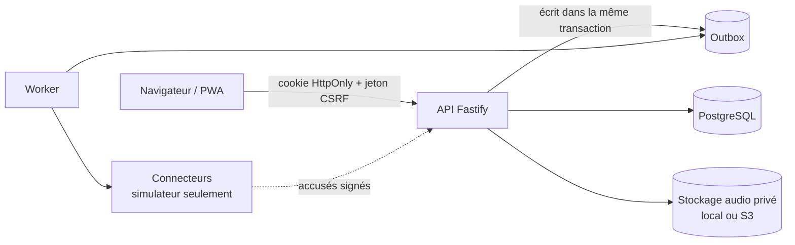

# Architecture et choix techniques

## Vue d'ensemble

Monolithe modulaire, trois paquets dans un dépôt unique (espaces de travail npm) :

```
packages/core   Logique métier partagée, sans base de données : machine à états, catégories,
                classificateur et son interface de remplacement, évaluation, contrats Zod.
apps/api        Fastify 5 + Prisma 7 + PostgreSQL 16. API REST documentée (OpenAPI), sessions,
                droits, outbox et worker, connecteurs, stockage audio privé.
apps/web        React 19 + TypeScript + Vite 8, PWA. Quatre espaces : bénéficiaire, agent,
                structure, administration.
legacy/         Prototype v0.1 d'origine, intact et exécutable (npm run legacy:start).
```



En production, l'API sert aussi l'interface compilée : **une seule origine**, ce qui permet des cookies `SameSite=Strict` et une politique de sécurité de contenu stricte (`script-src 'self'`).

## Versions retenues (vérifiées le 25/10/2026, épinglées)

Node ≥ 22 · TypeScript 6.0.3 · Fastify 5.12.7 · Prisma 7.10.1 · PostgreSQL 16 · React 19.3.1 · Vite 8.3.5 · Zod 4.6.7 · Vitest 5.0.5 · Playwright 1.64.1.

- **Prisma 7.10.1 et non 8** : l'étiquette npm « latest » pointait sur une version candidate 8.0.0-rc ; la dernière version stable est 7.10.1.
- **TypeScript 6.0.3 et non 7.0** : la 7.0 (réécriture native) est parue le jour même ; plusieurs outils déclarent encore `typescript < 7`.
- Toutes les dépendances sont épinglées à une version exacte (`package-lock.json` versionné).

## Adaptations par rapport à l'architecture demandée

| Demandé | Retenu | Pourquoi |
|---|---|---|
| Routage React standard | **Routeur interne minimal** (`apps/web/src/router.tsx`, ~60 lignes) | `react-router` mesuré à **+33 Ko compressés** pour 6 fonctions utilisées. Choix réversible : mêmes noms d'API. |
| Stockage S3 « MinIO » en local | **SeaweedFS** (profil `s3` de Docker Compose) ou **répertoire privé** par défaut | Le dépôt `minio/minio` n'est plus publié sur Docker Hub (vérifié). Aucun service externe n'est requis en local. |
| Docker Compose | Docker Compose **et** script `npm run db:start` | Le démon Docker n'était pas disponible sur la machine de développement ; le script crée une instance PostgreSQL isolée sans toucher aux autres. |
| Bibliothèque d'authentification | **Sessions serveur opaques** (voir ci-dessous) | Besoins spécifiques (inscription assistée, code personnel, récupération supervisée) mal couverts par les solutions clés en main ; modèle recommandé par l'OWASP. |

## Authentification : choix justifié

- **Sessions opaques en base**, pas de JWT : le cookie `rm_session` (HttpOnly, `SameSite=Strict`, `Secure` obligatoire en pilote/production) porte 32 octets aléatoires ; la base n'en garde que le hash SHA-256. Révocation immédiate (déconnexion, désactivation de compte, récupération), expiration d'inactivité (15 min bénéficiaires et administrateurs, 30 min autres) et plafond absolu (8 à 12 h). Les droits sont **relus à chaque requête**.
- **CSRF** : jeton lié à la session, servi par `/api/auth/me`, gardé **en mémoire uniquement** par l'interface et exigé sur toute modification ; contrôle d'origine sur les requêtes sans session (connexion).
- **Secrets hachés en argon2id** (paramètres OWASP : 19 MiB, t=2) : mots de passe, codes personnels, codes d'activation.
- **Bénéficiaires** : identifiant non prédictible `RM-XXXX-XXXX` + code personnel de 6 chiffres. Ce code étant court, il est protégé par un **verrouillage par compte** (5 échecs : 15 min ; 10 échecs : blocage, déblocage supervisé par un agent), une limitation par adresse et un refus des codes trop simples. Pas d'e-mail obligatoire, pas de compte enfant.
- **Administrateurs** : second facteur TOTP obligatoire pour toutes les fonctions d'administration, anti-rejeu du code.
- Limite du choix : pas de WebAuthn ni de récupération par SMS en v0.2.

## Poids des pages (objectif fixé et mesuré)

Objectif : **≤ 130 Ko transférés** au premier chargement de l'accueil, interface utilisable en **moins de 6 s** sur un réseau simulé à 400 kbit/s avec 400 ms de latence. Mesure Playwright du 25/10/2026 : **91 Ko, 2,8 s**. Leviers appliqués et mesurés : retrait de Zod de l'interface des mamans (point d'entrée dédié `@relais-maman/core/health-review`), espaces du personnel chargés à la demande, routeur interne, fichiers pré-compressés (le serveur envoyait d'abord 329 Ko non compressés). React 19 seul représente déjà environ 69 Ko compressés.

## Hypothèses consignées

1. Togo : fuseau `Africa/Lome` (UTC+0 sans heure d'été), montants des frais en XOF ; instants stockés en UTC.
2. Une **équipe** d'agents suit un ensemble de bénéficiaires ; une demande appartient à l'équipe de la femme au moment de sa création.
3. Le référent de structure voit uniquement les demandes ayant un créneau dans sa structure, en vue réduite.
4. L'administrateur ne lit pas le contenu individuel des demandes (moindre privilège) ; à revoir si un rôle de supervision est nécessaire.
5. Une bénéficiaire peut avoir des enfants rattachés (mois de naissance seulement), sans compte propre.
6. Mode « téléphone partagé » par défaut : rien de sensible sur le disque du téléphone.
