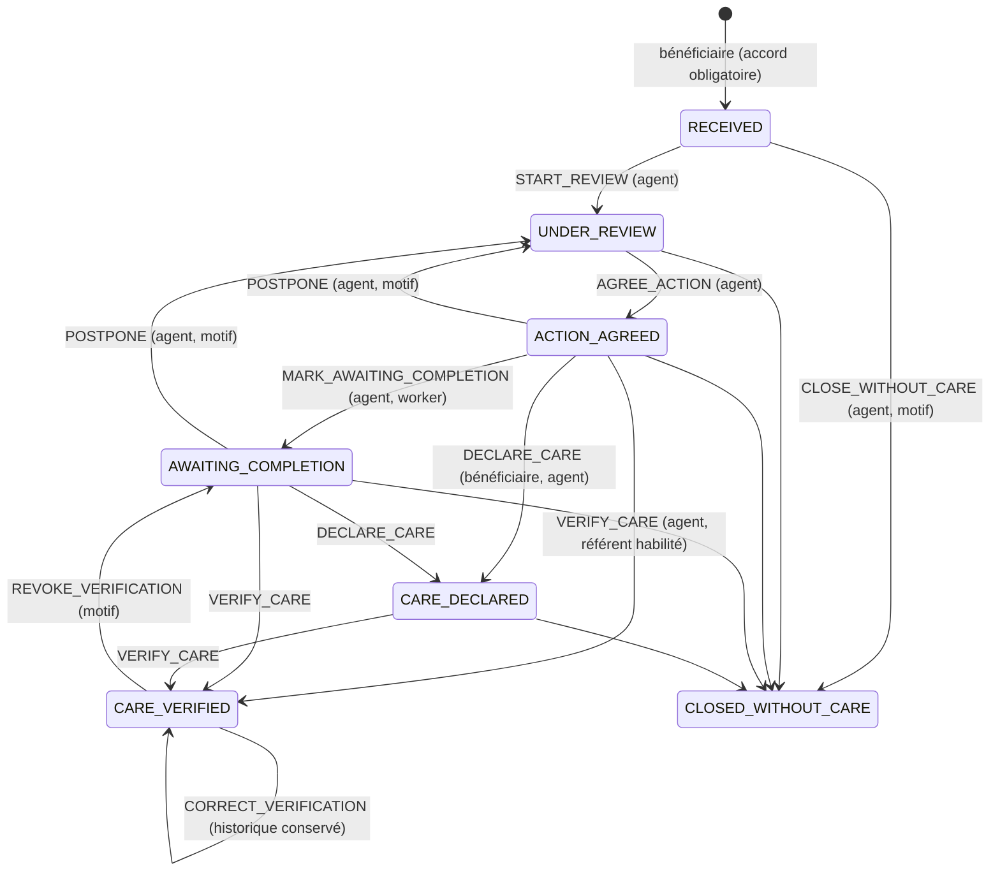

# États métier des demandes

Source de vérité : `packages/core/src/requestStateMachine.ts` (transitions et rôles), appliquée par `apps/api/src/services/requests.ts` (données requises, chronologie, version).

## États locaux et états serveur

| Famille | État | Où | Libellé affiché |
|---|---|---|---|
| Local | `DRAFT` | mémoire du navigateur | « À envoyer » |
| Local | `PENDING_SEND` | mémoire du navigateur | « Envoi en attente de connexion » |
| Serveur | `RECEIVED` | base | « Transmis au service » |
| (horodatage) | `firstViewedAt` | base | « Consulté par un agent » |
| Serveur | `UNDER_REVIEW` | base | « En cours d'examen » |
| Serveur | `ACTION_AGREED` | base | « Solution convenue » |
| Serveur | `AWAITING_COMPLETION` | base | « Soin à confirmer » |
| Serveur | `CARE_DECLARED` | base | « Vous avez dit avoir reçu le soin » |
| Serveur | `CARE_VERIFIED` | base | « Soin vérifié » |
| Serveur | `CLOSED_WITHOUT_CARE` | base | « Clos sans soin confirmé » |

Une demande n'est jamais dite « transmise » avant l'accusé du serveur.

## Contrôles à chaque transition

1. **Rôle autorisé** (table `TRANSITIONS`), puis **périmètre** : l'objet est chargé à travers le filtre d'accès, un dossier hors périmètre donne 404.
2. **État de départ** valide.
3. **Version attendue** (`expectedVersion`) égale à la version en base, sinon 409 : aucune modification concurrente n'est écrasée en silence.
4. **Données requises** :
   - `AGREE_ACTION` : une action concrète enregistrée ; catégorie décidée par un humain (pas une suggestion du modèle en attente, pas une question de santé) ; accord de transmission toujours valide ; créneau accepté dans l'application **ou** note sur l'accord obtenu par l'agent.
   - `POSTPONE`, `REVOKE_VERIFICATION`, `CORRECT_VERIFICATION`, `CLOSE_WITHOUT_CARE` : motif obligatoire.
   - `VERIFY_CARE` : date, source, méthode, auteur, note. Un référent n'enregistre qu'une **confirmation de structure** ; un agent qu'une **vérification d'agent**. Aucune pièce médicale exigée.
5. **Chronologie** : date de soin ni future ni antérieure à la demande (dates civiles d'`Africa/Lome`) ; créneau proposé dans le futur.
6. Le **worker** (`SYSTEM`) ne peut que basculer en « soin à confirmer » une fois le créneau accepté passé, et clôturer après retrait de l'accord de transmission (motif `CONSENT_WITHDRAWN` imposé).

## Créneaux

`PROPOSED` (agent) → `ACCEPTED` / `DECLINED` / `ALTERNATIVE_REQUESTED` (bénéficiaire) → `CONFIRMED_BY_FACILITY` (référent habilité de la structure concernée). Une nouvelle proposition remplace la précédente (`SUPERSEDED`). **Une note ou une action d'agent n'est jamais une réservation** auprès d'une structure.

## Journal

Chaque action écrit un `RequestEvent` (type, auteur, rôle, états, données sans texte libre ni téléphone). Le journal n'est jamais modifié ni supprimé par l'application.
